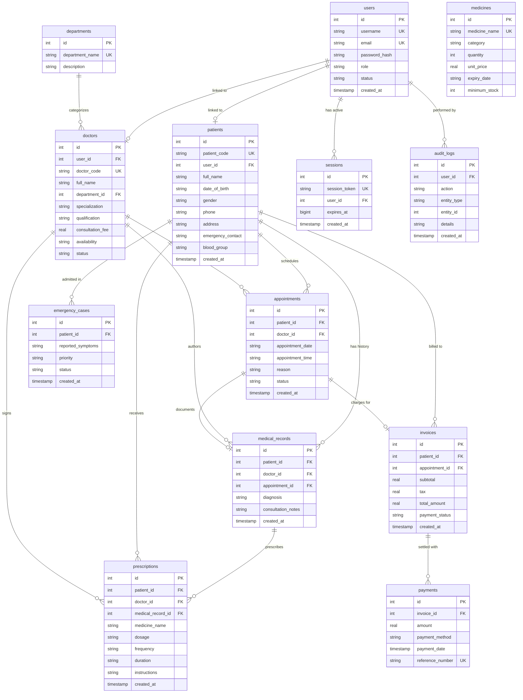

# Database Entity-Relationship Diagram (ERD)

The SQLite relational schema for the Hospital Management System (`hospital.db`) contains 13 relational tables linked with foreign keys, uniqueness constraints, and indexing.

