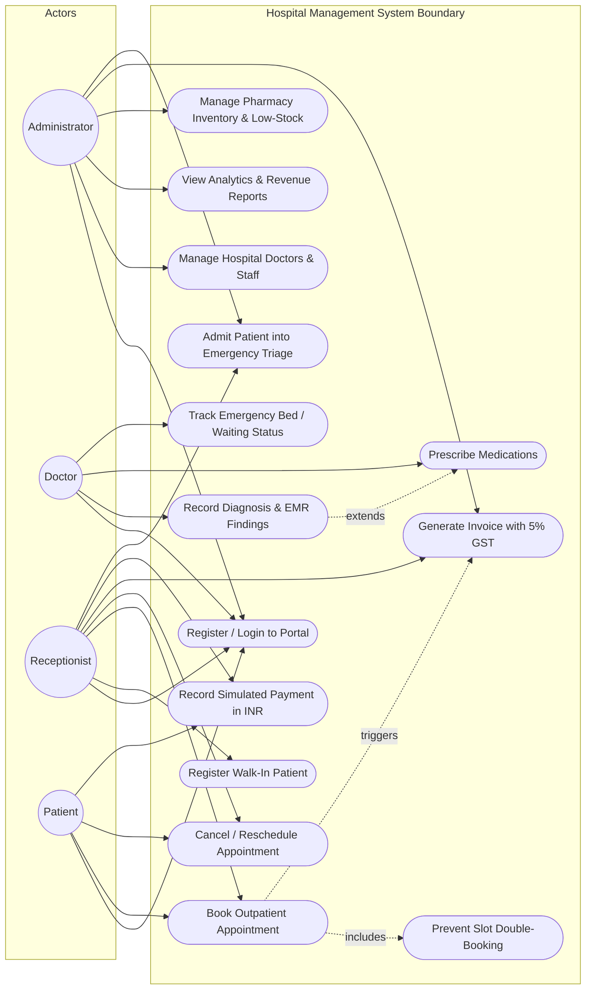

# UML Use Case Diagram - Hospital Management System

## Role Breakdown

| Role | Primary Responsibilities | Core Access |
|---|---|---|
| **Administrator** | Hospital governance, staff onboarding, financial analytics, system settings | Full Superuser Access to all tables and configurations |
| **Doctor** | Consultation queue, clinical diagnoses, electronic health records, prescriptions | Patient records, clinical EMR, prescription authoring, emergency queue |
| **Receptionist** | Front desk triage, walk-in patient intake, appointment scheduling, billing & cashier | Patients, appointment slots, invoices, simulated payment collection |
| **Patient** | Self-service registration, doctor directory search, appointment booking, invoices | Personal medical records, personal appointments, invoice receipts |

